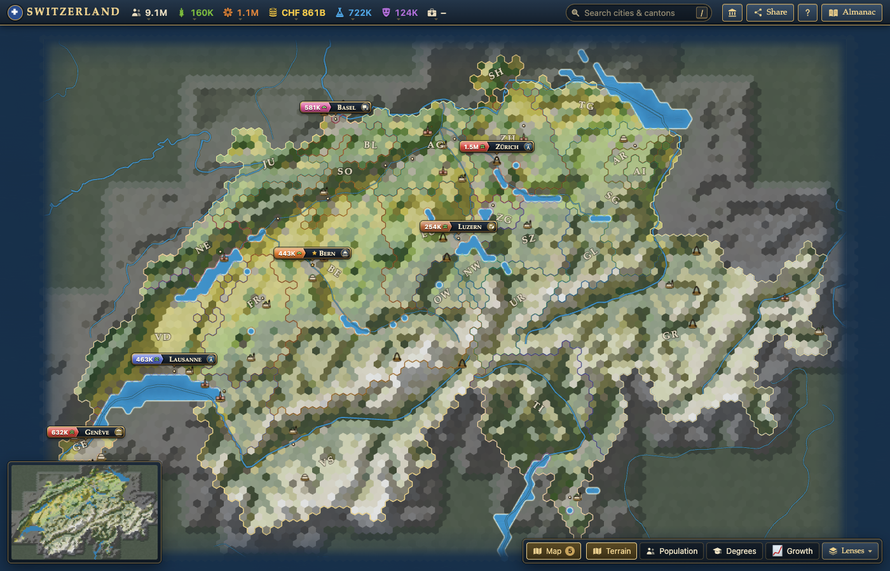
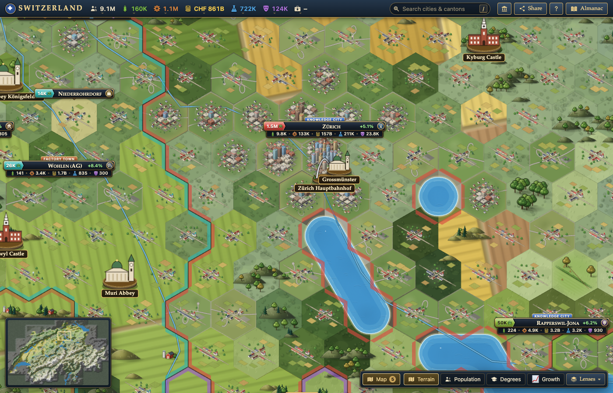
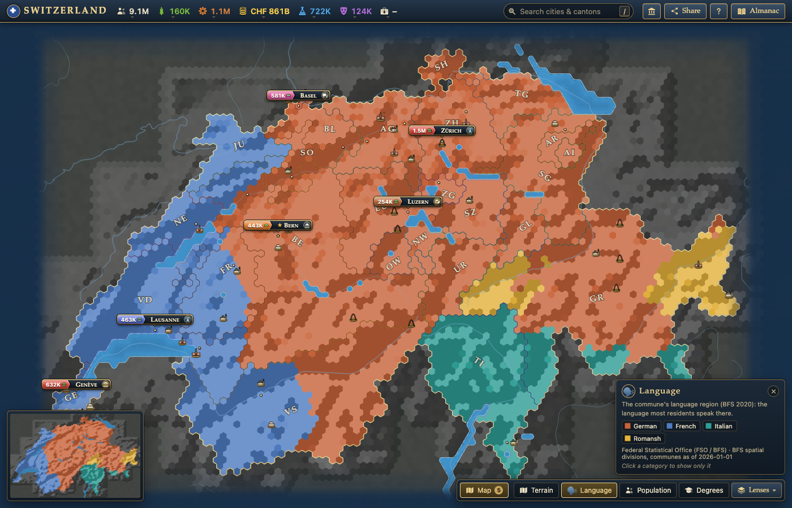

# swissciv: Switzerland as a strategy game, built from real data

A fork of [usaciv](https://karpathy.ai/usaciv/) by Andrej Karpathy (MIT). His map engine and all of the art are
unchanged; this copy replaces the US data pipeline with Swiss open data.



| Zürich up close | Language regions lens |
|---|---|
|  |  |

## What's in it

- **Map.** Hexes of 2 km radius in the Swiss LV95 grid. Relief comes from swisstopo DHM25/200. Land cover
  (forest, pasture, arable land, settlement, rock, glacier) comes from the BFS land use statistics. The 26 cantons
  and the lakes come from the BFS boundaries.
- **Cities.** The 2020 BFS agglomerations, plus towns of 10,000+ residents outside them. City tiles grow with the
  real number of residents in each hex (STATPOP hectare counts), so Zürich's skyline spreads over the hexes it
  really covers.
- **Yields.** Food, Production, Science and Culture are jobs by industry (STATENT, at the workplace). Gold is GDP:
  BFS publishes it by canton only, so a city's GDP is its canton's GDP split by its share of the canton's jobs.
- **City badges.** Location quotients on STATENT jobs give each city its districts and a badge, e.g. Basel
  "Pharma city", Biel "Watch town", Bern "Federal city", Luzern "Insurance city".
- **Landmarks.** Buildings from the federal inventory of cultural property of national importance (KGS, A
  objects), ranked by how many Wikipedia editions describe them (Wikidata sitelinks). The top 40 show on the map,
  and each city panel lists its top 3 to 5.
- **Lenses.** Population density, growth 2020–2025, language region, urban/rural, jobs per resident, tertiary
  education, the federal votes of 27 September 2026 (yes share, turnout), forest, farmland and built-up land.

## Run it

You need [uv](https://docs.astral.sh/uv/) (it fetches Python 3.11+). The built data in `web/data/` is included.

```bash
uv run python -m pipeline serve        # http://127.0.0.1:8765
```

`web/` is a static site; any static host works (GitHub Pages, Netlify, S3).

Rebuild the data from the publishers (about 300 MB of downloads into `data/raw/`, cached):

```bash
uv run python -m pipeline all
```

## How it works

The flow is the one from usaciv: **source → interim → builder → web/data**.

```
pipeline/
  core/swiss.py     LV95 ⇄ map km, WGS84 → LV95, the canton list
  sources/          swisstopo DHM, BFS boundaries, Arealstatistik, typologies, STATPOP, STATENT,
                    education, GDP by canton, KGS inventory, Wikidata, federal votes, Natural Earth rivers
  build/            world, economy (cities, cantons, nation), lenses, districts, wonders, catalog
web/                the original usaciv front end, with small changes for a smaller country
```

Changes to the front end: zoom limits and edge fog scale with the hex size; `nation.json` `pop_scale` lets the
city art treat Swiss agglomerations like larger US metros; a hex with enough residents gets its own city tile;
amounts are in CHF; city panels list landmarks.

`docs/DATA_CONTRACTS.md` is the original US contract. The Swiss files follow the same shapes; fields without a
Swiss source (income, rent, home value, unemployment) are `null`.

## Data and attribution

- Federal Office of Topography swisstopo: DHM25/200 (©swisstopo)
- Federal Statistical Office (Source: FSO): boundaries G1, Arealstatistik, spatial divisions, STATPOP, STATENT,
  educational attainment, GDP by canton, federal vote results
- Federal Office for Civil Protection (BABS): KGS inventory
- Wikidata (CC0), queried through the QLever mirror; Natural Earth (public domain)

Every file's URL, retrieval date and checksum are in `web/data/sources.json` and the in-app Almanac.

## Licence

MIT. See `LICENSE`. The original usaciv is © Andrej Karpathy.
